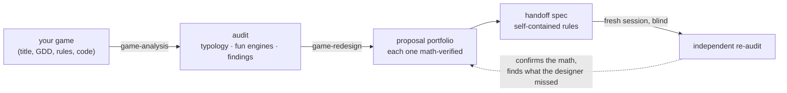

# Game Design Skills for Claude Code

[](https://github.com/apetrovCode/game-design-skills/actions/workflows/tests.yml)


Two [Claude Code](https://claude.com/claude-code) skills that turn a chat into
a game-design lab:

- **`game-analysis`** — audit any game (a published title, or your own design
  docs / rules text / prototype code): what type of game it is, what makes it
  fun, and what's broken — backed by real graph-theory computation wherever
  an interaction chart exists.
- **`game-redesign`** — takes that audit and proposes bold, theory-tested
  redesigns (new mechanics, matrix rewrites, fun-engine amplification),
  verifies each one against the same math engine, and hands back a spec
  built for an independent re-audit.

Together they form a loop: **analyze → redesign → verify the math → re-audit
blind.**



## Why this isn't just a fancy prompt

Both skills route load-bearing balance claims through
[`game-analysis/scripts/matrix_analysis.py`](game-analysis/scripts/matrix_analysis.py)
— a small, dependency-free Python script (standard library only, 34-test
suite included) that actually computes:

- cycle detection (transitive vs. intransitive — real graph traversal, not a guess)
- dominated-strategy detection
- "doom-stack" search — is any pair or triple of picks unbeatable together?
- eigenvector-centrality viability scores

So when a report says *"no dominated nodes"* or *"the 2-Paradox property
holds,"* that's a computed result you can re-run yourself — see
[`examples/`](examples/). Here's the entire engine's output on classic RPS:

```
$ python3 game-analysis/scripts/matrix_analysis.py tests/fixtures/rps.json

Mode: binary | Nodes: 3 (Rock, Paper, Scissors)

== STRUCTURE ==
Tournament: yes (tournament = every matchup has a winner)
INTRANSITIVE (cycle exists). Example cycle: Rock -> Scissors -> Paper -> Rock
3-cycles: 1

== DOMINATED NODES ==
Dominated nodes: none

== DOOM-STACKS (unbeatable subsets) ==
3 unbeatable subset(s) of size 2 — 2-Paradox property does NOT hold:
  ('Rock', 'Paper')
  ('Rock', 'Scissors')
  ('Paper', 'Scissors')

== VIABILITY (eigenvector centrality, steady-state heuristic) ==
  Paper: 0.3333
  Rock: 0.3333
  Scissors: 0.3333
```

That last section is why 3-sign RPS can never have a safe two-sign strategy —
and why the redesign skill's 7-sign expansion (see
[`examples/rock-paper-scissors/`](examples/rock-paper-scissors/)) is built on
the mathematically minimal graph where every pair *does* have a counter.

The skills are also disciplined about **matrix-before-narrative**: any claim
that leans on space, tempo, or hidden information has to say so explicitly,
and a spatial story is never allowed to paper over a matchup chart that's
actually broken. That rule exists because an early test run caught a
real-world design essay doing exactly that.

## What's inside

```
game-analysis/    the auditor  — typology, fun engines, balance diagnosis, levers
game-redesign/    the designer — bold proposals, theory-tested, re-audit handoff
tests/            34-test regression suite for the matrix script
examples/         real, unedited outputs from three full audit→redesign→re-audit loops
install.sh        copies both skills into ~/.claude/skills/
```

## Install

Requires Claude Code and `python3` on `PATH` (standard library only — nothing
to `pip install`).

```sh
git clone <this-repo-url>
cd game-design-skills
./install.sh
```

Start a **new** Claude Code session afterward so the skills register.

## Try it

```
break down rock paper scissors for me
```
```
do a deep design audit of Tetris
```
```
propose redesigns for the game in my-game-design.md
```

## The loop, proven

`examples/` has three real runs, unedited:

- **`rock-paper-scissors/`** — full audit → a portfolio of redesigns
  (including a weighted-value variant with a computed Nash equilibrium, and a
  proven-minimal 7-node "2-Paradox" roster) → the winning proposal's
  handoff spec → blind-re-audited in a fresh session with no memory of why it
  was designed that way.
- **`hex-crawler/`** — the same loop on a custom tactics-game design. The
  redesign proposes a 7-unit interaction chart; the blind re-audit
  independently proves it's the *unique* 2-Paradox tournament on 7 nodes and
  finds a real design gap — nothing forces engagement — that the original
  design session missed.
- **`tetris/`** — a single audit of a game with no interaction matrix at
  all, to show the skill correctly refuses to force one where none exists.

## Swap in your own theory

The knowledge base is deliberately modular. The files in
`game-analysis/references/` marked *"Claude-authored fill-in — replaceable by
curated content"* are exactly that: replace `fun-engines.md` or
`systemic-levers.md` (or `game-redesign/references/design-moves.md`) with
your own design-theory notes, update the one routing line in the relevant
SKILL.md, and the whole pipeline reasons from *your* framework instead —
with the same computational discipline underneath. If you fork this with a
different theory spine, I'd genuinely like to see it.

## Honest limits

This pipeline verifies **theory-consistency**, not fun. It can prove a
design isn't mathematically broken — no dominant strategy, no dead choices —
and it can generate mechanically sound ideas fast. It cannot tell you whether
a mechanic *feels* good. Every redesign document says so explicitly:
*"theory-consistent, not play-tested."* Playtesting is still the ground
truth — bring the notes back as input to the next audit, and the loop keeps
going.

## Provenance

The interaction-structure and workflow theory in `game-analysis/references/`
are curated from *Rock Paper Scissors 2*, a YouTube essay by **Fractal
Philosophy** — go watch it if you haven't. The rest of the framework cites
named canonical sources inline: MDA (Hunicke, LeBlanc & Zubek, 2004),
Koster's *A Theory of Fun*, Csikszentmihalyi's *Flow*, Ryan & Deci's
Self-Determination Theory, Machinations-style economy design (Adams &
Dormans), and Engelstein & Shalev on randomness placement.

Built with Claude Code using a spec → plan → subagent-reviewed development
workflow: brainstormed, spec'd, implemented task-by-task by fresh subagents,
reviewed, and validated across multiple blind test runs before being
packaged here.

## License

MIT — see [LICENSE](LICENSE).
